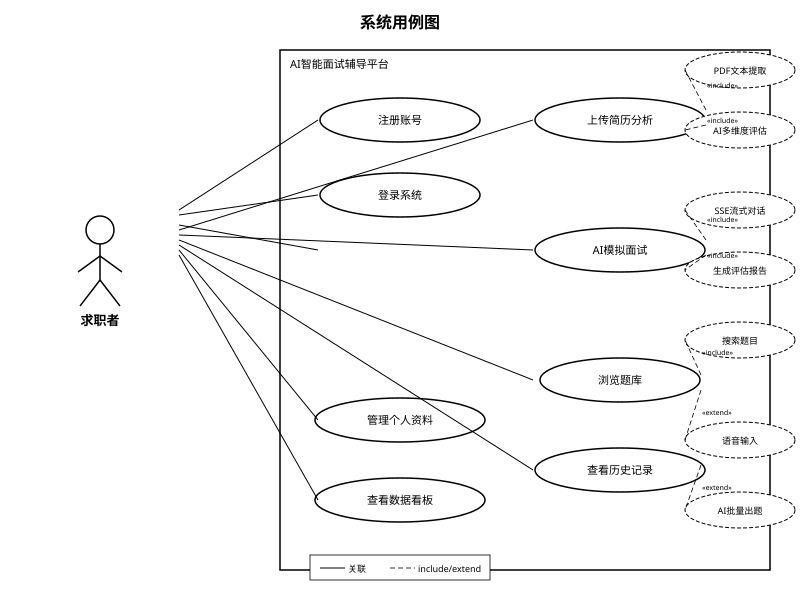
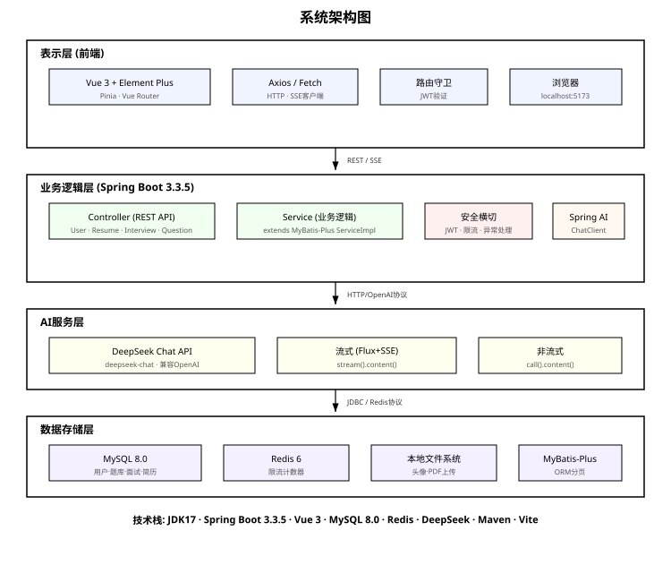
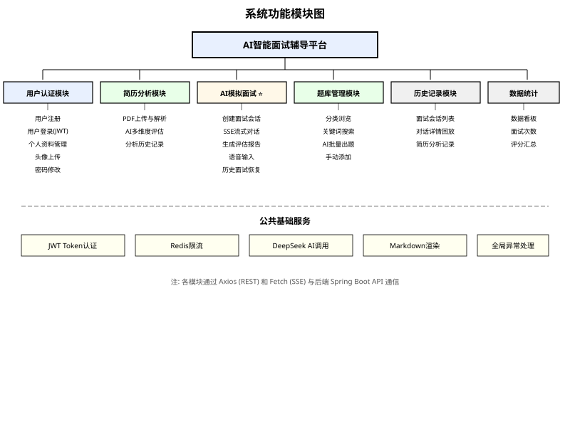
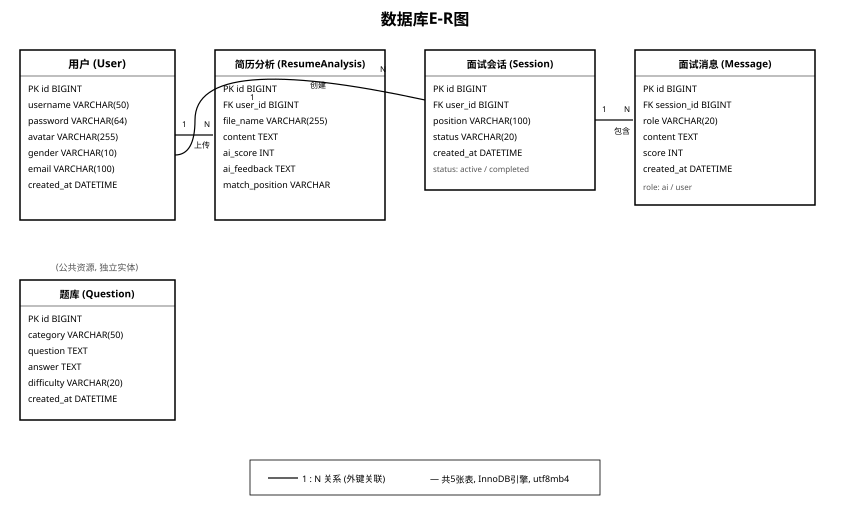

# AI Interview Coach

面向技术求职者的 AI 求职训练平台。项目把简历诊断、岗位匹配、AI 模拟面试、逐题评分、题库练习、训练档案和复盘报告整合成一套完整闭环，适合用于毕业设计、个人作品集和 Java/Vue 全栈项目展示。

## 项目亮点

- **岗位定向简历诊断**：PDF 简历解析、目标岗位/JD 输入、ATS 关键词覆盖、能力缺口、证据链和行动优先级分析。
- **流式 AI 模拟面试**：基于 SSE 的实时追问，支持技术深挖、项目复盘、系统设计、行为面试，多难度、目标轮次和鼓励/平衡/严格反馈风格配置。
- **逐题评分与复盘**：AI 回复统一输出简短点评、下一问和机器评分，结束后结合回答内容、表达时长、语速和填充词信号生成结构化面试总结。
- **训练驾驶舱**：准备度评分、7 天训练趋势、岗位分布、场景分布、低分回答摘录和今日训练计划。
- **面试题库系统**：公共题库、私有题目、AI 批量出题、随机练习、专注练习、掌握/待复习进度追踪。
- **个人训练档案**：头像、资料、安全设置、训练阶段、推荐下一步行动和成就徽章。
- **多用户数据隔离**：简历、面试、题目、头像、统计数据均按用户隔离，避免越权访问。
- **产品化前端体验**：响应式 SaaS 工作台、移动端底部导航、深色模式、3D 视觉场景、404 页面、统一错误提示。

## 页面预览

项目内置系统设计图，适合放在论文、答辩或 GitHub 展示中：

| 用例图 | 架构图 |
| --- | --- |
|  |  |

| 功能模块 | ER 图 |
| --- | --- |
|  |  |

## 技术栈

**后端**

- Java 17 / Spring Boot 3.3
- Spring AI / DeepSeek OpenAI-compatible API
- MyBatis-Plus / MySQL 8 / Flyway
- Redis / JWT / BCrypt
- Spring Boot Actuator / Micrometer / Knife4j
- PDFBox / JUnit 5 / Mockito

**前端**

- Vue 3 / Vite
- Pinia / Vue Router
- Element Plus / Element Plus Icons
- Axios / Fetch ReadableStream
- marked / Three.js

## 工程能力

- **AI 网关封装**：统一处理大模型调用、空响应检测、失败重试、耗时日志和场景标识。
- **SSE 流式输出**：前端使用 `fetch` + `ReadableStream` 消费增量文本，回答通过 JSON POST 请求体传输，后端持久化完整问答；同时保留 GET 兼容入口。
- **数据库版本管理**：Flyway 管理 V1-V6 迁移，新环境自动建表，旧环境支持 baseline 接管。
- **认证与会话控制**：JWT 登录态、token version、修改密码后撤销旧会话。
- **密码安全**：BCrypt 存储密码，兼容旧 MD5 并在登录成功后自动升级。
- **限流与降级**：Redis 限制 AI 调用频率，Redis 不可用时自动降级为本地内存限流。
- **资源安全**：头像上传限制类型和大小，通过鉴权接口读取，用户不能访问他人头像。
- **可观测性**：健康检查、Actuator、请求 ID 日志、Prometheus 指标按需开放。
- **前端工程体验**：路由标题、404 页面、统一错误归一化、移动端适配、按路由拆包。

## 项目结构

```text
interview-coach/
|-- backend/                 Spring Boot API
|   |-- src/main/java/com/interviewcoach/
|   |   |-- config/          AI、CORS、MVC、MyBatis 配置
|   |   |-- controller/      REST、SSE、健康检查接口
|   |   |-- service/         业务服务、AI 网关、数据隔离
|   |   |-- interceptor/     JWT 登录拦截
|   |   |-- exception/       全局异常处理
|   |   `-- utils/           JWT、限流等工具
|   `-- src/main/resources/
|       `-- db/migration/    Flyway 数据库迁移
|-- frontend/                Vue 3 单页应用
|   `-- src/
|       |-- views/           首页、简历、面试、题库、历史、个人中心
|       |-- stores/          用户与主题状态
|       |-- api/             Axios、SSE URL、错误处理
|       |-- components/      Three.js 视觉组件
|       `-- utils/           Markdown 渲染
|-- diagram/                 架构图、ER 图、流程图
|-- docs/                    初始化脚本和历史迁移脚本
|-- docker-compose.yml       本地容器化编排
`-- .env.example             环境变量模板
```

## 本地运行

环境要求：

- JDK 17+
- Maven 3.9+
- Node.js 18+
- MySQL 8
- Redis 6+

复制环境变量模板：

```powershell
Copy-Item .env.example .env
```

至少需要配置：

```env
DEEPSEEK_API_KEY=replace-with-your-deepseek-key
INTERVIEW_DB_PASSWORD=replace-with-a-strong-database-password
INTERVIEW_JWT_SECRET=replace-with-at-least-32-random-characters
```

> 不要把真实 `.env`、API Key、数据库密码提交到 GitHub。

可以先运行环境自检脚本，快速确认本机工具、端口和关键环境变量：

```powershell
.\scripts\check-env.ps1
```

严格模式会在必填环境变量缺失时返回非 0 退出码：

```powershell
.\scripts\check-env.ps1 -Strict
```

启动后端：

```powershell
cd backend
mvn spring-boot:run
```

启动前端：

```powershell
cd frontend
npm install
npm run dev -- --host 0.0.0.0
```

默认地址：

- Web: `http://localhost:5173`
- API: `http://localhost:8080`
- API Docs: `http://localhost:8080/doc.html`
- Health: `http://localhost:8080/api/health`

手机访问时，确保手机和电脑在同一局域网，然后使用 Vite 输出的 `Network` 地址，例如 `http://192.168.x.x:5173`。

## Docker 一键启动

```powershell
Copy-Item .env.example .env
docker compose up --build -d
```

查看服务：

```powershell
docker compose ps
docker compose logs -f backend
```

停止服务：

```powershell
docker compose down
```

Compose 会启动 MySQL、Redis、后端和前端服务，并使用命名卷保存数据库、头像和 Redis 数据。

## 数据库迁移

后端启动时会由 Flyway 自动执行迁移：

- `V1__initial_schema.sql`：初始表结构
- `V2__add_operational_indexes.sql`：运行索引
- `V3__add_resume_target_context.sql`：简历岗位上下文
- `V4__add_question_practice_progress.sql`：题库练习进度
- `V5__add_user_token_version.sql`：会话版本
- `V6__add_interview_training_profile.sql`：面试训练画像字段
- `V7__add_interview_feedback_style.sql`：面试反馈风格

`docs/init.sql` 仅用于全新数据库初始化演示。已有数据环境不要重复执行初始化脚本。

## 测试与构建

后端测试：

```powershell
cd backend
mvn test
```

前端构建：

```powershell
cd frontend
npm run build
```

## 环境变量

| 变量 | 说明 | 示例 |
| --- | --- | --- |
| `DEEPSEEK_API_KEY` | DeepSeek API Key | `sk-...` |
| `INTERVIEW_DB_PASSWORD` | MySQL 密码 | `your-password` |
| `INTERVIEW_JWT_SECRET` | JWT 签名密钥，建议 32 位以上 | `a-long-random-secret` |
| `INTERVIEW_AI_TIMEOUT_SECONDS` | AI 调用超时时间 | `45` |
| `INTERVIEW_CORS_ORIGINS` | 允许跨域来源 | `http://localhost:5173` |
| `INTERVIEW_ACTUATOR_ENDPOINTS` | 开放的 Actuator 端点 | `health,info` |

## 可写进简历的项目描述

AI Interview Coach 是一个基于 Spring Boot 3 与 Vue 3 的智能求职训练平台，覆盖简历诊断、AI 模拟面试、题库练习和训练复盘闭环。项目通过 Spring AI 接入 DeepSeek，设计统一 AI 网关处理重试、空响应和调用观测；使用 SSE 实现上下文感知的流式模拟面试，并将对话持久化后生成逐题评分和结构化能力评估；基于 JWT、token version 和查询级 `userId` 条件实现多用户数据隔离；使用 Flyway 管理数据库迁移、Redis 限流及本地降级保障可用性；前端采用 Vue 3、Pinia、Element Plus 和 Three.js 构建响应式训练工作台，支持移动端、深色模式、3D 可视化和完整复盘体验。

## 开源协作

- 提交代码前请阅读 [CONTRIBUTING.md](CONTRIBUTING.md)。
- 安全问题请遵循 [SECURITY.md](SECURITY.md)，不要在公开 Issue 中披露漏洞或用户隐私。
- 项目使用 [MIT License](LICENSE)。
